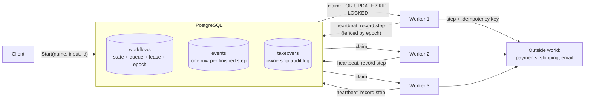

# stepwise

A durable workflow engine in Go, backed by PostgreSQL.

You write a multi-step job as an ordinary Go function. The engine saves the
result of every step before starting the next one. If the process running it
is killed half-way, another worker picks the job up, skips the steps that are
already saved, and finishes it. Nothing is lost and no saved step runs again.

```go
e.Register("order", stepwise.Typed(func(c *stepwise.Context, in Order) (Receipt, error) {
    charge, err := stepwise.Step(c, "charge_card", func(ctx context.Context, info stepwise.StepInfo) (Charge, error) {
        return payments.Charge(ctx, in.Card, in.Amount, info.IdempotencyKey)
    })
    if err != nil {
        return Receipt{}, err
    }
    if _, err := stepwise.Step(c, "ship_order", shipIt(in)); err != nil {
        stepwise.Step(c, "refund_card", refund(charge)) // compensation
        return Receipt{}, err
    }
    c.Sleep(24 * time.Hour) // durable: survives restarts, holds no worker
    stepwise.Step(c, "send_review_email", email(in))
    return Receipt{ChargeID: charge.ID}, nil
}))

id, _ := e.Start(ctx, "order", order, "order-1042") // the id doubles as an idempotency key
```

## Architecture



Workers hold no state of their own. Everything a workflow needs to continue is
in PostgreSQL, so any worker can finish what another one started.

## What it does

| Feature | How |
|---|---|
| Crash recovery | Append-only event log per workflow; recovery replays the function against the log |
| Many workers, one queue | `SELECT ... FOR UPDATE SKIP LOCKED` so workers never block or double-claim |
| Dead worker detection | Leases with heartbeats; an expired lease makes the workflow claimable again |
| No split brain | Fencing token (`epoch`) checked inside every write, so a replaced worker cannot write |
| Retries | Per-step attempts with exponential backoff; `Permanent(err)` skips retries |
| Compensation (sagas) | A step that fails for good returns an error the workflow handles, for example by refunding |
| Durable timers | `Sleep` stores the wake-up time and parks the workflow in the database |
| Low latency | `LISTEN/NOTIFY` wakes workers on new work; polling is only a fallback |
| Safe code changes | Replay checks each step against history and fails loudly on a mismatch |
| Audit log | Every takeover is logged in the same statement as the claim |

The engine is about 930 lines: [stepwise.go](stepwise.go), [store.go](store.go),
[worker.go](worker.go), [context.go](context.go). [DESIGN.md](DESIGN.md) explains
why each piece is there and what it does not do.

## Failure model: what happens when X dies

| Failure | What the engine does | What is guaranteed | Tested by |
|---|---|---|---|
| Worker process is killed (`SIGKILL`, OOM, machine lost) | Heartbeats stop, the lease expires, another worker claims the workflow and replays it | Saved steps do not run again. The step that was in flight may run again, with the same idempotency key | `chaos`, `TestCrashedWorkerIsReplaced...` |
| Worker is frozen or cut off but not dead (GC pause, `SIGSTOP`, network partition) | Looks dead, so it is replaced: a **false takeover**. When it wakes, every write it makes carries an old epoch and is rejected | Only one worker can ever append to a history | `chaos --stall-every`, `TestFencingRejectsWrites...` |
| Worker shuts down normally (deploy) | Hands its workflows back at once; nobody waits for a lease | No delay, nothing repeated beyond the step in flight | `TestGracefulStopHandsWorkBack...` |
| PostgreSQL crashes or restarts | Workers keep retrying. Steps in flight retry with backoff; step results that could not be saved are not treated as done. After recovery, work resumes from the last committed step | Anything committed survives. Nothing is recorded twice | `chaos --db-crash-every` |
| PostgreSQL is down for longer than a step's retry budget | The step fails for good and the workflow runs its compensation once the database is back | No half-finished order: it is either completed or compensated | Covered by design, not by an automated test |
| A step fails temporarily (timeout, 503) | Retried in place with exponential backoff | Recorded once, with the attempt count | `chaos --flaky-pct`, `TestRetriesThenSucceeds` |
| A step fails for good (card declined, address rejected) | Recorded as failed; the workflow gets an error and runs compensation steps, which are durable steps themselves | The undo runs exactly as reliably as the original steps | `chaos --refund-pct`, `TestPermanentFailureTriggersCompensation` |
| Client retries `Start` after a timeout | The workflow id is a primary key; the second insert does nothing | One workflow per id | `TestStartIsIdempotentByID` |
| Workflow code is changed while instances are running | Replay compares each step with history | The workflow fails with a clear error instead of silently doing the wrong thing | `TestChangedWorkflowCodeIsDetected...` |
| PostgreSQL loses its disk | Nothing. The database is the single source of truth | None. Use replication and backups | Not handled |

## Run it

Needs Go 1.25+ and PostgreSQL 14+ (`brew install go postgresql@17`). Run these
from the repository root.

```bash
scripts/dev-db.sh
```

```bash
go build -o bin/stepwise ./cmd/stepwise
```

### Demo: kill a worker mid-order

```bash
./bin/stepwise demo
```

Open http://127.0.0.1:8765. Start an order, then press **Kill -9** on the worker
that is running it. The order shows "worker dead", and about three seconds later
another worker finishes it from the step it was on. The dashboard is served by
a separate process from the workers, so it stays up while they die.

### Chaos test

The chaos test runs four-step orders on four worker processes, attacks the
system while they run, and then verifies the outcome from the database.

| Flag | Fault injected | Default |
|---|---|---|
| `--kill-every 400ms` | `SIGKILL` a random worker | on |
| `--stall-every 1s` | Freeze a random worker with `SIGSTOP` for 3 s (three times the lease), then `SIGCONT` | off |
| `--db-crash-every 6s` | Stop PostgreSQL with an immediate shutdown (no checkpoint, crash recovery on restart), keep it down 2 s | off |
| `--flaky-pct 5` | A step's first attempt fails | on |
| `--refund-pct 5` | Shipping fails for good, so the order must be refunded | on |

`--db-crash-every` only works against a local PostgreSQL you own, such as the
one from `scripts/dev-db.sh`. It restarts that server, so do not point it at a
database anything else depends on.

Workers only:

```bash
./bin/stepwise chaos --workflows 10000
```

Everything at once:

```bash
./bin/stepwise chaos --workflows 10000 --stall-every 1s --db-crash-every 6s
```

Results from this repository on 13 Nov 2026 (10,000 orders each, 500 of them refund orders):

| | Workers only | Everything at once |
|---|---:|---:|
| Time | 23.0 s | 50.3 s |
| Workers killed (`SIGKILL`) | 57 | 109 |
| Workers frozen (`SIGSTOP`) | 0 | 42 |
| PostgreSQL crashes | 0 | 8 |
| Takeovers from a dead worker | 832 | 1,306 |
| False takeovers (owner was still alive) | 0 | 214 |
| Steps that ran twice, absorbed by idempotency keys | 280 | 505 |
| Orders lost or stuck | 0 | 0 |
| Histories with a missing, repeated or reordered step | 0 | 0 |
| Effects applied (wanted 39,500) | 39,500 | 39,500 |
| Wrong receipts | 0 | 0 |
| Refund orders not refunded exactly once, or shipped | 0 of 500 | 0 of 500 |

Full output of the second run:

```
10000 orders in 50.3s
  109 workers killed (SIGKILL)
  42 workers frozen for 3s (SIGSTOP, then SIGCONT)
  8 PostgreSQL crashes (immediate shutdown, down 2s each)
  1520 takeovers after a lease expired
      1306 from a worker that was dead
      214 from a worker that was still alive (false takeovers; fencing stops the old owner writing)
  40005 step executions for 39500 effects: 505 repeats, all absorbed by idempotency keys

  [PASS] no order lost or stuck (10000 of 10000 finished in the right state)
  [PASS] every history has the right steps in order, once each (0 bad)
  [PASS] every effect applied exactly once, in order (39500 applied, want 39500)
  [PASS] every receipt matches the expected value (0 wrong)
  [PASS] every order that could not ship was refunded exactly once and never shipped (500 orders)
```

How to read it:

- **Repeats** are steps whose worker died, froze or lost the database after
  the side effect happened but before the result was saved, so the step ran
  again. The engine cannot prevent that (nothing can); it hands every step a
  stable idempotency key so the second run is harmless.
- **False takeovers** are workflows taken from a worker that was still alive.
  They are counted by comparing the engine's takeover log with the time each
  worker process actually died. Each one is a case where two workers believed
  they owned the same workflow, and the fencing token decided between them.
- The counts change from run to run because the faults are random. The five
  PASS lines should not.

### Tests

```bash
go test -race .
```

Ten integration tests against a real PostgreSQL: crash takeover, graceful
hand-back, fencing, no double-claim across four workers, retries, compensation,
durable sleep across a worker change, idempotent start, and replay mismatch.

### Benchmark

```bash
./bin/stepwise bench
```

Results on an Apple M4 laptop (16 GB), PostgreSQL 17 on the same machine,
Go 1.27. Steps do no work, so this is the engine's own overhead: one committed
write per step, plus claim and completion.

**Throughput, one worker process** (5,000 workflows of 4 steps, queued up front; range over four runs)

| Concurrency | Workflows/sec | Steps/sec |
|---:|---:|---:|
| 1 | 1,100 to 1,600 | 4,400 to 6,400 |
| 4 | 3,200 to 4,000 | 12,700 to 15,800 |
| 16 | 5,000 to 7,300 | 19,900 to 29,200 |
| 64 | 3,200 to 5,100 | 12,700 to 20,300 |

**Scaling out** (20,000 workflows of 4 steps, N worker processes at concurrency 4 each; one run)

| Worker processes | Workflows/sec | Steps/sec | Speed-up |
|---:|---:|---:|---:|
| 1 | 2,536 | 10,142 | 1.00x |
| 2 | 3,492 | 13,970 | 1.38x |
| 4 | 4,138 | 16,553 | 1.63x |
| 8 | 3,496 | 13,985 | 1.38x |

Scaling is well short of linear and goes backwards at 8. The workers are not
the limit: PostgreSQL is, and here it shares ten cores with every worker. More
workers past that point only add contention on the same table. On separate
machines the curve would flatten later, but it would still flatten, because
every step is a commit to one database.

**Latency** from `Start` to completion (steady arrivals for 10 s, 4 steps each; range over four runs)

| Arrival rate | p50 | p95 | p99 |
|---:|---:|---:|---:|
| 100/sec | 1.8 to 2.0 ms | 2.9 to 3.3 ms | 3.3 to 7.5 ms |
| 400/sec | 1.0 ms | 1.5 to 7.1 ms | 1.8 to 179 ms |
| 1,600/sec | 0.5 to 1.5 ms | 0.8 to 4.9 ms | 1.7 to 80 ms |

Read these with care:

- **The laptop was on battery in Low Power Mode.** That explains some of the
  run-to-run spread and the occasional p99 spike. Re-run plugged in before quoting numbers.
- **macOS does not truly flush to disk on commit** with PostgreSQL's default
  settings, so commits are cheaper here than on a Linux server with real `fsync`.
- **Database and workers share one machine**, so there is no network hop and
  they compete for the same CPU cores.

## Layout

```
stepwise.go     Engine, Register, Start, Get, Wait
store.go        schema and every SQL statement (claim, record, finish, heartbeat)
worker.go       poll loop, execution, heartbeats, LISTEN/NOTIFY
context.go      Step, Sleep, retries
engine_test.go  integration tests
cmd/stepwise/   demo dashboard, supervisor, chaos test (kills, freezes, database crashes), benchmark
```
